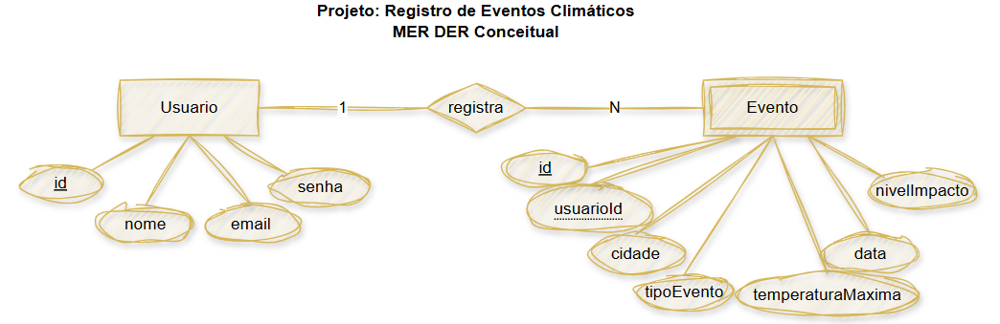
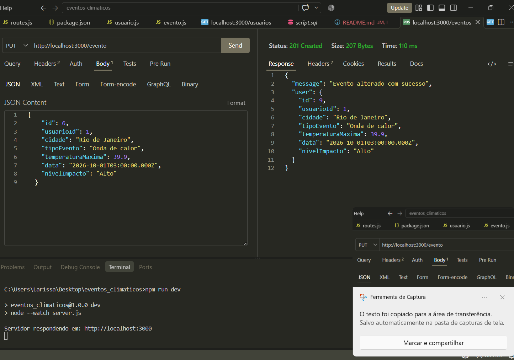
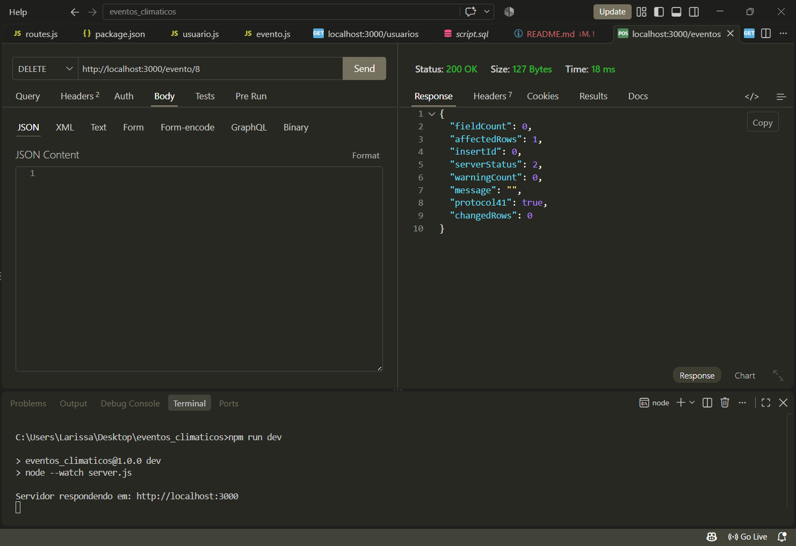
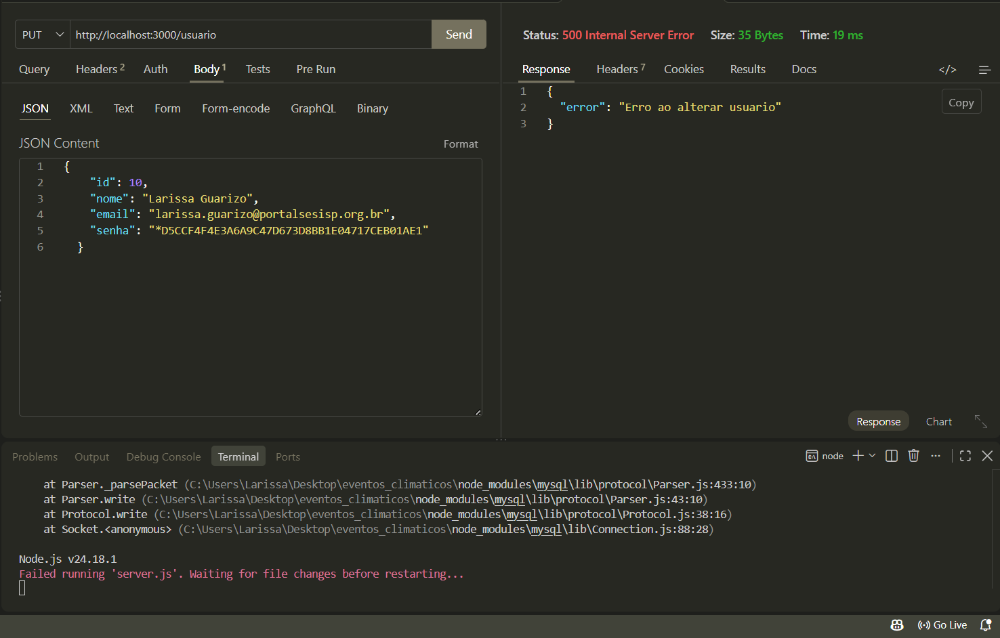
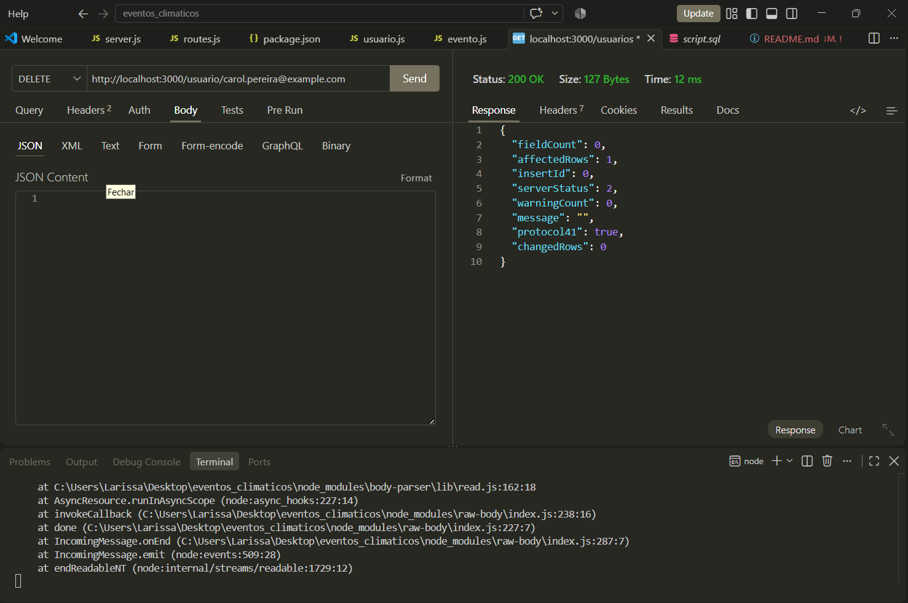

# backend_aula09_eventos_climaticos_desafio

## Tecnologias
- VS Code
- Mysql
- Node.js
- Express

# Descrição 

## Testes alterar/excluir prints

- Alterar evento

- Excluir evento 

- Alterar usuário

- Excluir usuário

